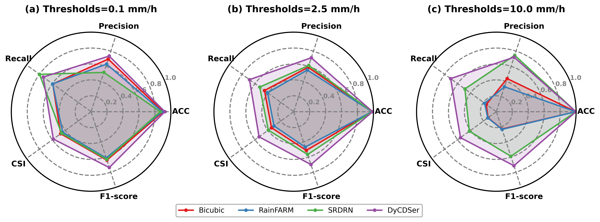

# DyCDSer: A Dynamics-guided Two-stage Network for Precipitation Correction and Downscaling

Official implementation of the paper "DyCDSer: A Dynamics-guided Two-stage Network for Precipitation Correction and Downscaling".
## Abstract
Recovering high-resolution precipitation from coarse reanalysis fields is essential for fine-scale meteorological and hydrological analyses. However, ERA5 precipitation
exhibits systematic biases in both intensity and location, which pose substantial challenges to end-to-end downscaling. Here we present DyCDSer, a
dynamics-guided framework that decouples the task into low-resolution bias correction followed by spatial downscaling. The corrector explicitly characterises
the discrepancy between reanalysis and forecast winds through differentiable divergence and vorticity operators, and corrects the intensity and advective location
errors separately under physics-guided gates that prevent over-correction. The downscaler then progressively recovers high-resolution detail, with multiscale
wind information injected at every upsampling stage. On an eightfold downscaling task of ERA5 total precipitation over Taiwan, DyCDSer outperforms
the traditional interpolation method Bicubic, the statistical downscaling method RainFARM and the deep-learning method SRDRN across intensity
reconstruction, event detection, spatial structure, location accuracy and distribution. Moreover, all baselines improve consistently when supplied with the corrected fields, demonstrating that correction-then-downscaling is an effective
and transferable strategy for precipitation downscaling.

## Framework

## Requirements

- Python 3.8
- PyTorch 2.1.0 + CUDA 12.1
- 
## Data Preparation

- ERA5 reanalysis: download from [ECMWF CDS](https://cds.climate.copernicus.eu/)
- Target: the NVIDIA NGC catalogue at https://catalog.ngc.nvidia.com/orgs/nvidia/teams/modulus/resources/modulus\_datasets\_cwa.

## Results

